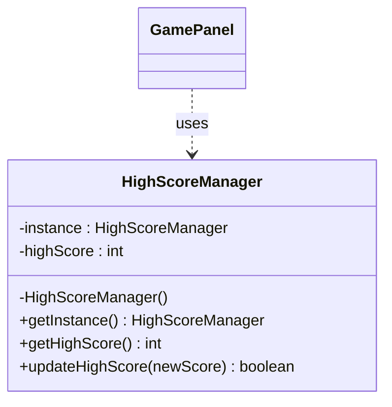
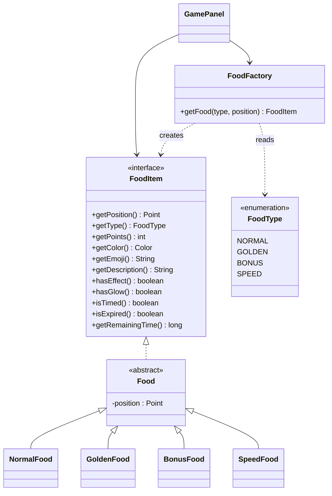

# 🐍 Snake Game: Creational Design Patterns

A Java Swing Snake game refactored to apply the **Singleton** and **Factory** creational design patterns.

**Course:** Software Design Patterns (CPIT-251), University of Jeddah
**Phase:** 1 (creational patterns only)


---

## Credit

The base game was **not written by our team**. It comes from the open-source project
[bibekchandsah/snake-game](https://github.com/bibekchandsah/snake-game).

Our contribution in this phase is the design-pattern refactoring only:

| Contribution | Classes |
|---|---|
| Singleton pattern | `HighScoreManager` |
| Factory pattern | `FoodItem`, `Food`, `FoodType`, `FoodFactory`, `NormalFood`, `GoldenFood`, `BonusFood`, `SpeedFood` |
| Integration | Changes in `GamePanel` so it depends only on `FoodItem` and `FoodFactory` |
| Cleanup | Removed duplicated code, dead code and type checks; unified line endings; added `.gitignore` |

---

## Design Patterns Used

### 1. Singleton: `HighScoreManager`

**Problem:** The high score is shared state stored in one file (`highscore.dat`).
Two instances could hold different values and overwrite each other's file.

**Solution:** The class controls its own creation. The constructor is private, and
the only way to get the object is `getInstance()`, which creates it on first use (lazy
initialization). The method is `synchronized` so it is thread-safe.

```java
public class HighScoreManager {
    private static HighScoreManager instance = null;

    private HighScoreManager() { loadHighScore(); }

    public static synchronized HighScoreManager getInstance() {
        if (instance == null) {
            instance = new HighScoreManager();
        }
        return instance;
    }
}
```



### 2. Factory: Food creation

**Problem:** The game spawns four kinds of food. If `GamePanel` created them with `new`,
it would depend on every concrete class and need to change whenever a food type is added.

**Solution:** `FoodFactory` is the only class that knows which concrete class belongs to
which `FoodType`. `GamePanel` asks the factory for a `FoodItem` and uses it through the
interface, so it never sees `NormalFood`, `GoldenFood`, `BonusFood` or `SpeedFood`.
Behaviour that differs by type (glow, countdown, speed effect) is exposed as methods on
the product, so the client has no `if (type == ...)` checks.

```java
FoodItem food = foodFactory.getFood(FoodType.GOLDEN, position);
score += food.getPoints();
```



---

## Food Types

| Food | Points | Effect |
|---|---|---|
| 🍎 Normal | 1 | None |
| ⭐ Golden | 5 | Appears every 15 seconds |
| 💎 Bonus | 3 | Appears every 20 seconds, disappears after 5 seconds |
| ⚡ Speed | 1 | 10% chance to appear; 40% faster movement for 5 seconds |

---

## Project Structure

```
snake-game/
├── SnakeGame.java          # Main window and entry point
├── GamePanel.java          # Game loop, snake logic, rendering
├── SettingsPanel.java      # Difficulty, wall mode, Start/Pause button
├── HighScoreManager.java   # Singleton: high score persistence
├── FoodType.java           # Enum of food kinds
├── FoodItem.java           # Factory product interface
├── Food.java               # Abstract base class for all foods
├── NormalFood.java         # Concrete product
├── GoldenFood.java         # Concrete product
├── BonusFood.java          # Concrete product (expires after 5 s)
├── SpeedFood.java          # Concrete product (speed boost)
├── FoodFactory.java        # Factory: creates the right FoodItem
├── build.ps1               # Windows build script (JAR + EXE)
├── BUILD.md                # Build instructions
├── launch4j-config.xml     # EXE wrapper configuration
└── icon.png / icon.ico     # Application icons
```

`highscore.dat` is created automatically on first run and is ignored by Git.

---

## How to Build and Run

**Requirements:** JDK 11 or higher.

```bash
javac *.java
java SnakeGame
```

On Windows, `build.ps1` compiles the code and builds the JAR and EXE
(see [BUILD.md](BUILD.md)).

---

## How to Play

| Key | Action |
|---|---|
| ⬆️ / `W` | Move up |
| ⬇️ / `S` | Move down |
| ⬅️ / `A` | Move left |
| ➡️ / `D` | Move right |

- Press **Start** to begin and use the same button to pause and resume.
- **Difficulty:** Easy (150 ms per move), Medium (100 ms), Hard (50 ms).
- **Wall collision:** when ON, hitting a wall ends the game; when OFF, the snake wraps to the other side.
- Hitting your own body always ends the game.
- Your best score is saved between sessions.

---

## Team

| Name | Student ID |
| --- | --- |
| Wahaj Alsuwat | 2314965 |
| Haya Alsaab | 2310344 |
| Renad Khormi | 2310448 |
| Basma Jameel | 2312333 |

**Instructor:** Dr. Fatimah Asiri
---

## License and Academic Use

This repository is a university coursework project built on top of an open-source game.
Please refer to the [original repository](https://github.com/bibekchandsah/snake-game)
for the license of the base code.
